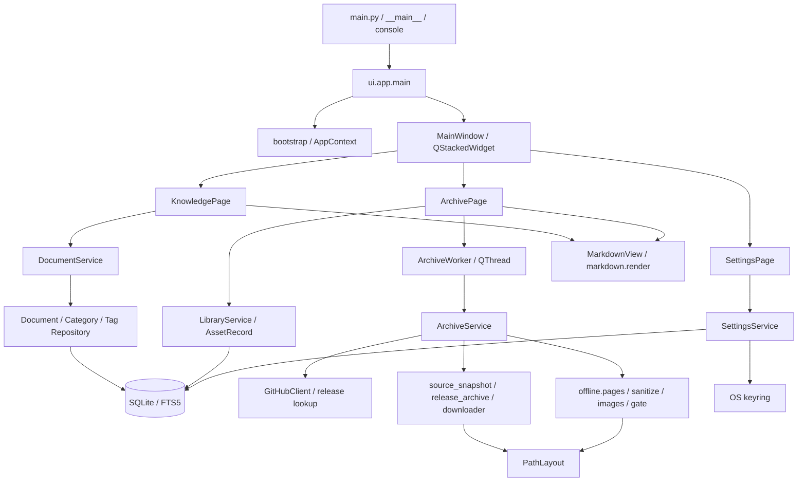

# TechVault 全项目架构与 UI/UX 审计

审计日期：2026-10-14（Asia/Shanghai）  
源码基线：`eabd1724da3d3d65a47e5abf9fddc4ab7d3e117b`（`main`，工作区除本报告外无未提交改动）  
范围：全项目生产源码、六份 SQL 迁移（`migrations/001`–`006`）、构建配置；相关测试仅作交叉证据，不作为视觉验收  
模式：**STRICT READ-ONLY**；唯一写入物为本报告。未启动应用入口、未连接用户数据库、未读取系统 Token、未触发 GitHub 下载、未修改存档或配置。

本轮在既有草稿基础上独立重读全部 UI / app / documents / archive / github / offline / db / markdown 生产模块，并用合成输入做纯内存核验（Markdown 转义、README HTML 片段截断、无下一 `h2` 时空片段）。

## 1. 结论与验收状态

TechVault 是 **Python 3.11+ / PySide6 Qt Widgets** 桌面应用，已具备：业务服务层、SQLite 持久化、独立归档线程、共享 Markdown 阅读器、统一暗色主题 token。当前问题**不是**“没有主题”或“没有分栏”，而是：**主题未形成完整布局与组件契约**；详情区把元数据、README、资料状态与任务进度混在同一列；内容渲染存在 **Markdown（禁嵌 HTML）与离线 HTML 回退**两套不一致路径。

优先风险在**操作正确性**而非纯视觉：关闭窗口可丢失未保存知识草稿；任务取消按钮藏在已隐藏的添加弹窗内，且离线页面阶段不响应取消；旧存档存在时“已保存”可能遮蔽最近一次更新失败。其次是 README 标签原文显示、HTML 回退截断/空片段、元数据高度上限、列表硬截断与多滚动域。下载层经 `GitHubClient.request` 预缓冲响应，使进度与取消反馈失真。

- **源码覆盖与功能/UI 映射：PASS。** 已建立入口→页面→服务→存储→下载→渲染调用链；问题均有源码定位。
- **纯内存行为核验：PASS（有限）。** 本轮验证：内嵌 HTML 被转义为可见标签文本；README HTML 回退在下一 `h2` 前截断；**无下一 `h2` 时片段为空**。无用户数据、无网络。
- **视觉及真实环境验证：NOT VERIFIED。** 未获得原始截图及对应窗口尺寸/DPI/字体/内容样本；未启动真实 GUI（默认启动会写库、补分类、恢复中断任务，违反只读边界）。
- **缺陷整改关闭：NOT CLOSED。** 本轮未修复任何问题。
- **最终全项目审计状态：NOT CLOSED。** 静态审计交付完成 ≠ UI 验收通过。

状态术语：

| 标记 | 含义 |
|------|------|
| SOURCE CONFIRMED | 源码已确认机制或缺口 |
| MEMORY VERIFIED | 合成输入纯内存核验 |
| NOT VERIFIED | 需布局/运行/真实数据验证 |
| NOT CLOSED | 证据或整改闭环尚缺 |

源码路径相对项目根 `D:/project/TechVault`；行号对应当前基线。

---

## 2. 项目架构与主要模块关系

### 2.1 技术栈与版本

`pyproject.toml:5-31`：项目 `0.1.0`，Python `>=3.11`，依赖下限 PySide6 `>=6.6`、httpx `>=0.27`、keyring `>=25`、markdown-it-py `>=3`、mdit-py-plugins `>=0.4`、nh3 `>=0.2`。无依赖锁文件。

本机 `.venv` 只读元数据（证明本地开发环境，不证明终端用户安装）：

| 组件 | 版本 |
|------|------|
| Python | 3.11.9 |
| PySide6 / Qt | 6.11.2 |
| httpx | 0.28.1 |
| keyring | 25.7.0 |
| markdown-it-py | 4.2.0 |
| mdit-py-plugins | 0.6.1 |
| nh3 | 0.3.7 |
| SQLite | 3.45.1 |

GUI：手工 Qt Widgets；无 `.ui` / QML / WebEngine。内容阅读用 `QTextBrowser`，编辑用 `QPlainTextEdit`。GitHub 为同步 httpx，在 `QThread` 内执行；非 asyncio，非多文件并行下载。

### 2.2 入口与页面路由

| 入口 | 位置 |
|------|------|
| `main.py:10-17` | 将 `src` 加入 `sys.path`，调用 `techvault.ui.app.main` |
| `src/techvault/__main__.py:3-5` | `python -m techvault` |
| `pyproject.toml` scripts | `techvault = techvault.ui.app:main` |
| `ui/app.py:18-32` | `QApplication` → `apply_theme()` → `open_window_context` → 日志 → `MainWindow.show()` → `exec()` |
| `ui/main_window.py:16-62` | 左栏 `QListWidget#mainNav`（固定宽 120）驱动 `QStackedWidget`：知识 / GitHub 项目 / 设置 |

`MainWindow._show_section:60-62` 仅切换 stack 并将状态栏置“就绪”；无路由历史、无离开编辑检查。

默认启动**不是只读**：`app/bootstrap.py:47-66` 会连接库、迁移、设默认 archive_root、补默认知识分类、调用 `recover_interrupted_archives`。本轮未调用。

### 2.3 模块关系



### 2.4 分层与耦合

- **知识**：UI 只调 `DocumentService`，不写 SQL。边界清晰。证据：`knowledge_page.py:25-30,386-418`；`documents/service.py`；`documents/repository.py`。
- **GitHub**：UI → `LibraryService`（列表/详情）+ `ArchiveWorker` → `ArchiveService`（查找、快照、Release、离线页）。`archive`/`offline` 多处直接持有连接并写 SQL/文件系统，无统一 Repository 门面——架构事实，不等于必须先大重构。
- **UI 展示计算偏重**：`ArchivePage._show_selected` 拼版本/Topics；`_show_assets` 映射状态；`KnowledgePage.refresh_documents` 拼摘要。适合提取展示模型与通用控件，不宜先造框架。
- 后台包不导入 UI；跨层为 dataclass / 状态字符串 / 回调。`tests/test_ui.py` 有静态边界检查，不能证明布局正确。

### 2.5 主题、字体与组件体系

`ui/theme.py`：颜色 token、间距 `XS–XXL`（4/8/12/16/24/32）、圆角 8、`MARKDOWN_CSS`、Fusion + QPalette + 全局 QSS；字体 Microsoft YaHei UI 10pt；按钮 `primary/danger/filter/quiet`；标签 `tone`。

已有共享件：`MarkdownView`、`tags.parse_tag_input`、`i18n` 文案。**缺失**：PageHeader、FilterRail、ListRow、DetailHeader、TaskPanel、EmptyState、ErrorBanner、CategoryManager 等契约组件。Markdown CSS 颜色为独立字符串，未从 token 生成。有主题基础，无完整设计规范。

### 2.6 线程、下载、进度与生命周期

- `ArchiveWorker(QThread)`：`run` 内自开 SQLite 连接，Signal `progress/detail/completed`，`cancel` 仅 `Event.set()`。`archive_worker.py:18-70`。
- 单页同时只允许一个 worker；无队列/暂停/续传/ETA/任务中心。
- `TransferPlan`（`archive/progress.py`）按阶段合并字节进度，约 200ms 节流；快照与 Release 各用独立 plan，百分比**非**端到端总进度。
- `downloader.download_release_file`：1 MiB 分块写 `.part`，校验后 `os.replace`。但上游 `GitHubClient.request`（`client.py:78-83`）使用普通 `httpx.Client.request`，响应体先缓冲再 `iter_bytes`——网络期无进度、取消难以及时生效、大文件有内存风险。SOURCE CONFIRMED。
- `MainWindow.closeEvent:50-55`：取消归档后 `wait(3000)`，不检查返回值，不检查知识草稿。

---

## 3. 完整功能清单与业务流程

数据位置为源码规定的默认路径，本轮未读取用户实际目录内容。

### 3.1 存储位置

| 数据 | 默认位置 | 说明 |
|------|----------|------|
| SQLite | `%LOCALAPPDATA%/TechVault/techvault.sqlite`（无 LOCALAPPDATA 则 `~/TechVault/`） | `bootstrap.default_database_path` |
| 项目存档根 | 同上目录下 `archive/`，可在设置中改 | `settings.archive_root` |
| 日志 | 数据库父目录 `logs/` | `ui/app.py:25`，**不是** archive_root 下 logs |
| Token | OS keyring `TechVault` / `github-pat` | 不入 SQLite |

知识：SQLite `documents` / `categories` / `tags` / `document_tags` + FTS5 `document_search`。无独立 Markdown 文件库、无附件。

GitHub 元数据与任务：`repositories`、`repository_topics`、`repository_categories`、`releases`、`source_snapshots`、`release_files`、`jobs`、`offline_pages` 等。

磁盘树（`PathLayout`）：

```text
<archive_root>/
  repositories/<github_repo_id>/
    readme/README.md
    source/<snapshot_id>/source-code.zip
    releases/<github_release_id>/attempts/<attempt_id>/...
    pages/index.html | release.html | media/...
  _tmp/<job_id>/<file_id>.part
```

`PathLayout.database_path` / `repository_json` 等路径存在，但生产路径**不**把库迁到 `data/`，也**不**写 repository.json。

### 3.2 知识文档归档（真实能力）

| ID | 能力 | 入口 | 流程要点 | 存储 | 评价 |
|----|------|------|----------|------|------|
| K01 | 新建/保存 | 「新建」、空库自动编辑 | `save_document` → `DocumentService.create/update` → Repository + FTS；标题必填 | SQLite body/title/… | **已实现**；无自动保存/附件/导入导出/版本/回收站 |
| K02 | 编辑/取消/草稿保护 | 「编辑」「取消」 | `_leave_editor` 在切换文档/新建时提示保存/放弃/取消 | 内存草稿 | **部分**：关窗与主导航切换**未**接入 |
| K03 | 删除 | 「删除」确认 | `delete_document`；标签字典保留 | SQLite | **已实现**；无撤销 |
| K04 | 搜索/筛选 | 顶栏搜索、类型、分类、收藏、标签 | 250ms 防抖；FTS 前缀 AND；默认 limit=50 | FTS5 | **已实现但无分页 UI** |
| K05 | 分类/标签 | 筛选栏选分类；编辑填标签 | 服务有分类 CRUD API；**知识页无分类管理 GUI**；默认英文分类启动补齐 | SQLite | GUI 仅选用/筛选 |
| K06 | 阅读/复制/收藏 | 列表选中；复制/收藏 | `MarkdownView.set_markdown`；复制原始正文 | — | **已实现**；反馈位置有问题见 UI-03 |
| K07 | 异常 | 保存校验 | 仅捕 `DocumentValidationError`；SQL/收藏/删除无通用兜底 | — | **薄弱** |

主要文件：`ui/knowledge_page.py` → `documents/service.py` → `documents/repository.py` → migrations `001`/`004`。

### 3.3 GitHub 项目归档（真实能力）

| ID | 能力 | 入口 | 流程要点 | 评价 |
|----|------|------|----------|------|
| G01 | 添加项目 | 「添加项目」对话框 + URL | `ArchiveWorker` → `archive_repository`：解析 URL → 查仓库/官方 latest → 快照 →（STABLE 则）Release → 离线页 | **已实现**；不可选历史/预发布 |
| G02 | 源码快照 | 添加/更新流程内 | ZIP 默认分支；成功才改 `current_snapshot_id`；`commit_sha` 现为 NULL | **已实现**（非 git clone） |
| G03 | 正式 Release | 同上 | 仅 STABLE；源码包+全部 uploaded 附件；校验后提升指针 | **已实现** |
| G04 | README/离线页 | 自动 | HTML 清理+图片本地化 → `pages/index.html`；另存 `readme/README.md` | **已实现有降级** |
| G05 | 列表/搜索/分类/排序 | 分类栏、搜索、排序、管理分类 | 本地 SQLite LIKE；分类 CRUD；**无删除项目 GUI** | **已实现** |
| G06 | 更新/单项重试 | 「更新项目」；资料行按钮 | 全量重跑；README/SOURCE/RELEASE 可条件重试 | **已实现有状态遮蔽** |
| G07 | 打开 | 查看 README / GitHub / 本地 | 外部程序打开 index.html / URL / 文件夹 | **已实现** |
| G08 | 进度/取消/恢复 | 详情区进度；取消钮 | cancel Event；lookup/offline 阶段弱；启动 `recover_interrupted_archives` | **部分** |
| G09 | 异常反馈 | 结果标签/状态栏 | `user_message` 映射；分类 CRUD 未捕 DatabaseError | **部分** |

主要文件：`ui/archive_page.py` → `ui/archive_worker.py` → `app/archive_service.py` → `archive/*` + `github/*` + `offline/*` + `app/library.py` + `app/assets.py`。

### 3.4 设置

| ID | 能力 | 说明 |
|----|------|------|
| S01 | 存档目录 | 浏览+保存；只影响**新**归档路径；不迁移知识库/日志 |
| S02 | GitHub Token | 设/清；状态 Configured/Not configured/Unavailable；**不验证**有效性 |
| S03 | 关于 | 静态 0.1.0；无主题/字体/备份/更新检查 |

文件：`ui/settings_page.py` → `app/settings.py` → `security/token_store.py`。

### 3.5 明确未实现（勿当已有）

知识：自动保存、分类管理 GUI、标签管理 GUI、附件、导入导出、分页、回收站。  
GitHub：删除仓库、批量操作、选版本/选附件、任务队列、暂停续传、正文全文搜、独立 Release GUI 页、项目收藏。  
设置：Token 测试连接、库路径配置、数据迁移工具。

---

## 4. 当前 GUI 页面与组件结构

### 4.1 主窗口

- 初始 `1440×900`，最小 `960×640`（`main_window.py:20-21`）
- 导航固定宽 120；三页启动时全部构造；默认知识
- `closeEvent` 只处理归档取消

### 4.2 知识页（`KnowledgePage`）

```
[标题] [搜索..............] [新建]
┌筛选 148px─┬─列表 min220─┬─详情 stack min320────┐
│类型(高132)│ 空态/文档项 │ browse | edit | empty │
│收藏       │             │ MarkdownView / 编辑器 │
│分类列表   │             │ 操作行               │
│标签过滤   │             │                      │
└───────────┴─────────────┴──────────────────────┘
```

`QSplitter` stretch `0:2:3`，不可 collapse，无 saveState。

### 4.3 GitHub 项目页（`ArchivePage`）

```
[标题]
[搜索] [排序] [管理分类] [添加项目]
┌分类 132px─┬─列表 min260─┬─详情 min340────────────────────┐
│全部/未分类│ 多行纯文本项 │ detail_label maxH=148 (可滚)   │
│用户分类   │             │ readme_view (伸展, 可滚)       │
│           │             │ asset 状态行                  │
│           │             │ 分类下拉 + 打开/更新按钮      │
│           │             │ 进度条 + 状态横排 + 结果文案  │
└───────────┴─────────────┴───────────────────────────────┘
```

弹窗：添加项目（非模态 `show()`）、管理分类（仅三按钮无列表）、若干 `QMessageBox`/`ask_text`。

### 4.4 设置页

单列：存储组、GitHub 组、关于、状态；`QFrame#settingsSection` **未被**主题 `#surface` 规则覆盖。无外层滚动。

### 4.5 共享阅读器

`MarkdownView` → `_Reader(QTextBrowser)`：横滚 `AlwaysOff`，`maxWidth=760`，`MARKDOWN_CSS`；`render_markdown(..., html=False)`。

---

## 5. UI 缺陷清单（P0 / P1 / P2）

### P0

本轮**未确认** P0。无生产数据/截图支撑“全应用不可用或普遍数据损坏”。

### P1

#### UI-01｜关闭窗口未保护知识草稿 — SOURCE CONFIRMED

- **页面**：知识  
- **现象**：编辑/新建后直接关窗，草稿随进程丢失，无确认。  
- **位置**：`main_window.py:50-55 closeEvent`；`knowledge_page.py:509-518 _leave_editor` 仅新建/切文档调用。  
- **根因**：草稿协议未覆盖主窗口生命周期。  
- **整改**：关窗前走保存/放弃/取消；保存失败阻止退出。

#### UI-02｜取消入口藏在隐藏弹窗；离线页阶段不响应取消 — SOURCE CONFIRMED

- **页面**：GitHub 项目  
- **现象**：任务开始后主界面无可见取消；更新/重试同样依赖该按钮；页面构建阶段关窗/取消仍可能继续写。  
- **位置**：`archive_page.py:209` cancel 在 `add_dialog`；`343-344` 启用后 `hide()`；`archive_service.py:149-154` `build_offline_pages` 无 Event；`offline/pages.py:41-49` 无取消参数。  
- **整改**：常驻任务面板取消；lookup/页面/图片阶段合作取消。

#### UI-03｜知识保存/复制/删除提示写到不可见编辑区 — SOURCE CONFIRMED

- **位置**：`knowledge_page.py:202` `status_label` 仅在 editor；`417-419` 先切 browse 再写「已保存」；`451`/`440-442` 同理。  
- **整改**：可见反馈区或 toast；草稿/已保存/失败分态。

#### UI-04｜知识列表硬限前 50 条 — SOURCE CONFIRMED

- **位置**：`documents/service.py:105-106,131-132` 默认 `limit=50`；`refresh_documents:303-316` 未传分页；无“加载更多”。  
- **整改**：分页/增量 + 数量提示；勿一次取消 LIMIT 拉全量。

#### UI-05｜README 内嵌 HTML 显示为原始标签 — SOURCE CONFIRMED + MEMORY VERIFIED

- **现象**：`<p align=...>`、`` 等以标签文本出现（与用户截图观察一致的**机制**；截图样本对应关系 NOT VERIFIED）。  
- **位置**：`library.readme_document:401-404` 优先 Markdown；`_show_readme:675-676` → `set_markdown`；`markdown/render.py:22` `html=False`。  
- **核验**：`foo <span>bar</span> baz` → `&lt;span&gt;...`。  
- **整改**：应用内优先展示经现有 sanitizer 的 HTML；或安全白名单渲染。勿直接 `html=True`。

#### UI-06｜README HTML 回退截断 / 无下一 h2 时空片段 — SOURCE CONFIRMED + MEMORY VERIFIED

- **现象**：无 `README.md` 时依赖 `index.html` 片段，可能只显示引言，或显示「尚未保存」。  
- **位置**：`library.py:441-446 _readme_html_fragment` 正则 `<h2>README</h2>(.*?)<h2>`。  
- **核验**：有下一 `h2` 时在边界截断；**无下一 `h2` 时返回 `''`**（本轮新增确认）。  
- **整改**：用明确容器边界提取；兼容旧 HTML。

#### UI-07｜下载预缓冲导致进度/取消失真 — SOURCE CONFIRMED

- **位置**：`github/client.py:78-83`；`downloader.py:99,119-125`。  
- **整改**：真正 `stream=True` 传输；慢速合成流验证进度与取消。本轮未重复 MockTransport 实验。

#### UI-08｜关窗最多等 3 秒不确认线程结束 — SOURCE CONFIRMED

- **位置**：`main_window.py:50-55`；默认读超时 30s（`client.py:42-45`）。  
- **整改**：收尾完成后再关；勿强制杀线程。具体崩溃行为 NOT VERIFIED。

#### UI-09｜README 请求失败映射为「没有 README」 — SOURCE CONFIRMED

- **位置**：`offline/pages.py:262-270`；`_publish` 带 failure 仍可 COMPLETED；`assets.py:55-56` ABSENT 不可重试。  
- **整改**：区分 absent / failed / degraded。

#### UI-10｜旧存档「已保存」遮蔽最近更新失败 — SOURCE CONFIRMED

- **位置**：`assets.py:69-82` 有 current 指针即 SAVED；`_show_selected:620-624` 清空临时结果；详情未展示 `operation_label`/`last_job_message`。  
- **整改**：并行展示「本地可用」与「最近更新结果」。

#### UI-11｜运行任务与当前选中项目绑定不清 — SOURCE CONFIRMED

- **位置**：归档时仍可切换列表；进度挂在详情栏全局控件；`repository_label` 隐藏（`174`）；完成后按结果名强制选中。  
- **整改**：独立任务栏标明 owner/repo。

#### UI-12｜数据错误无完整 UI 兜底 — SOURCE CONFIRMED

- **位置**：知识仅捕验证错误；`create/rename_category` 可抛 `DatabaseError` 无捕（`archive_page.py:539-573`）。  
- **整改**：操作边界捕获 + 可重试反馈。

#### ARC-01｜Token 可随非 HTTPS URL 发送 — SOURCE CONFIRMED（先前 MEMORY VERIFIED 策略）

- **位置**：`github/redirect.py:17-19` 仅查 hostname；无 HTTPS 强制。  
- **整改**：认证限 HTTPS + 预期主机。本轮未复跑合成 URL 探测。

#### ARC-02｜旧 README.md 可遮蔽新页面/失败状态 — SOURCE CONFIRMED

- **位置**：`pages._store_readme_markdown:235-246` 失败保留旧文件；`readme_document:401-406` 只按文件存在优先。  
- **整改**：选择策略绑定构建时间/请求状态；勿简单删文件。

### P2

#### UI-13｜详情元数据 `maxHeight=148` — SOURCE CONFIRMED（视觉裁切 NOT VERIFIED）

- `archive_page.py:98`；长描述/Topics/附件名挤进独立滚动区。  
- **整改**：标题/短描述布局控件；版本信息进标签页/折叠。对应用户「文字被裁切」观察的**源码侧机制**。

#### UI-14｜列表字符硬截断、信息过密 — SOURCE CONFIRMED

- `archive_page.py:487-507,810-813`：描述 42、标识 72、Topics≤3；知识摘要 42（`598-602`）。  
- **整改**：结构化行 + 字体度量省略。

#### UI-15｜分类栏固定宽、分栏不可持久化 — SOURCE CONFIRMED

- 导航 120、知识筛选 148、项目分类 132；禁横滚；无 splitter saveState。名义最小宽合计未含边距/handle，960 是否够用 NOT VERIFIED。

#### UI-16｜禁横滚 + README maxWidth 760 — SOURCE CONFIRMED（实际溢出 NOT VERIFIED）

- `markdown_view.py:22-24`；`_DetailView:48`。

#### UI-17｜应用内 README 相对资源与离线 media 不一致 — SOURCE CONFIRMED

- base=readme 目录；图片在 `pages/media`；锚点/本地链接点击无响应（仅 http/https）。

#### UI-18｜分类管理弹窗无对象列表；知识分类无 GUI 管理 — SOURCE CONFIRMED

- `archive_page.py:213-221,781-791`；知识仅 `reload_categories`。

#### UI-19｜大列表全量同步重建、无防抖 — SOURCE CONFIRMED（卡顿阈值 NOT VERIFIED）

- `archive_page.py:307,470-508`；无 LIMIT。

#### UI-20｜设置/操作/状态横排无小窗重排 — SOURCE CONFIRMED（溢出 NOT VERIFIED）

#### UI-21｜任务百分比语义不明 — SOURCE CONFIRMED

- 独立 TransferPlan；`completed` 含已处理非仅成功；100% 仍显示校验。

#### UI-22｜文案/状态/主题应用不完全统一 — SOURCE CONFIRMED

- 默认英文分类；标准 `QMessageBox` 按钮未中文化；离线页英文；设置无 tone。

#### UI-23｜取消离开编辑后列表选中未恢复 — SOURCE CONFIRMED

- `knowledge_page.py:461-462,526-529`。

#### UI-24｜SOURCE/RELEASE 单项重试不重建离线页 — SOURCE CONFIRMED

- `archive_service.retry_failed_asset` 仅 README 分支调 `build_offline_pages`。

### 5.1 与用户截图观察的对照

| 观察 | 源码结论 |
|------|----------|
| 详情文字裁切/遮挡 | UI-13/16/20 机制 CONFIRMED；具体截图像素 NOT VERIFIED |
| README 原始 HTML 标签 | UI-05 MEMORY VERIFIED |
| 列表过密/截断 | UI-14 CONFIRMED |
| 多滚动嵌套 | **并列**多滚动域 CONFIRMED；外层套内层 QScrollArea **未发现**；“嵌套”说法 NOT VERIFIED |
| 分栏比例不合理 | UI-15 CONFIRMED；最佳比例待产品 |
| 下载/保存状态不清 | UI-02/03/10/11/21 CONFIRMED |
| 缺统一组件规范 | 有 theme，缺契约组件 CONFIRMED |

---

## 6. 建议的信息架构与页面布局（方案，本轮不执行）

### 6.1 导航与任务

保留「知识 / GitHub 项目 / 设置」。增加**独立常驻任务栏**（可折叠）：项目身份、阶段、进度、取消、最近结果——勿挂在详情正文下。先保持单 worker。

两业务共享「筛选 → 列表 → 详情」骨架，但状态机不同（本地草稿 vs 后台归档+旧版保护），勿强行合并。

```text
一级导航 | 标题 + 搜索 + 主操作
         | 可折叠筛选 | 可调列表 | 标题/摘要 + 内容标签
         |           |         | 单一主阅读纵滚
         |           |         | 对象状态 / 次要操作
         | 任务栏：身份 · 阶段 · 进度 · 取消 · 结果
```

### 6.2 知识

- 列表：标题、短摘要、类型/分类、收藏标识；可见结果数与加载更多。  
- 详情：阅读优先；编辑/预览明确切换；保存状态可见。  
- 关窗/切文档/新建统一草稿协议。  
- 分类是否开放 GUI 管理 → 产品决策。

### 6.3 GitHub 项目

- 列表：名称、短描述、**本地可用**与**最近更新**双状态。  
- 详情顶：身份、短描述、分类、版本摘要。  
- 标签建议：README / 版本与文件 / 归档信息。  
- 添加弹窗只输入；取消归任务栏。  
- 分类管理弹窗含列表与当前选中。

### 6.4 设置

说明目录只影响新项目资料；长路径可滚可复制；Token「已配置 ≠ 已验证」。继续 Qt Widgets，不引入 WebEngine/QML/新依赖。

---

## 7. 可复用组件与推荐设计规范

**优先提取**：PageHeader、FilterRail、LibraryListRow、DetailHeader、AssetStatusRow、TaskStatusPanel、InlineFeedback、EmptyState、CategoryManager、SafeContentReader。演进现有 `MarkdownView` / `theme` / `tags` / `i18n`。

**规范要点**：

1. 延续现有色板；状态靠文字+颜色，不单靠红绿。  
2. 间距 4/8/12/16/24/32；控件高度跟字体度量，忌固定高度压文本。  
3. 单一字号缩放策略；验收 100%/125%/150%/200% DPI 与大字号。  
4. 分类可折可调；splitter 比例可持久化到 UI 偏好（不影响存档路径）。  
5. 每页一个主正文纵滚；列表/筛选可并列滚；宽代码/表格局部横滚。  
6. 「本地可用」与「最近任务结果」分开展示。  
7. 网络任务显示阶段名；未知长度用不定进度；取消先「正在取消」。  
8. 安全渲染 HTML 与原始 Markdown 职责分离。  
9. 键盘焦点、tab 序、accessibleName 纳入验收（当前无完整无障碍规范）。

---

## 8. 分阶段整改计划与风险

本轮**不执行**下列任何阶段。

| 阶段 | 内容 | 主要项 | 风险 |
|------|------|--------|------|
| A | 隔离验证样本 | 长中英、HTML README、h2、宽表、0/51/1000 条、更新失败+旧成功 | 勿调用真实 prepare_context / Token |
| B | 操作正确性 | UI-01/02/03/07/08/09/10/11/12、ARC-01 | 线程生命周期、流式重定向/压缩 |
| C | 阅读与可达性 | UI-04/05/06/16/17/23、ARC-02 | 不得绕过 HTML 安全门 |
| D | 布局与组件 | UI-13/14/15/18/20 + 任务栏 | 重构易丢按钮/信号；对照 K/G/S 清单 |
| E | 性能与派生一致性 | UI-19/21/22/24 | 跨线程 SQLite 必须独立连接 |

**保护契约（整改不得破坏）**：知识正文与 SQLite 语义；`github_repo_id` 目录；快照≠Release；官方 latest 规则；校验与成功后指针提升；失败保留旧产物；跨 archive_root 定位；keyring Token；HTML 消毒。

---

## 9. 需要产品决策确认的问题

1. 目标最小分辨率/DPI/字号；960×640 是否承诺；窄屏是否允许单面板。  
2. 知识：纯手动保存 vs 自动保存/草稿恢复；关窗与切模块提醒策略。  
3. 知识分类/标签是否开放 GUI 管理；两模块分类是否继续独立（勿为外观合并表）。  
4. 添加项目是否仍默认下全量附件+双源码包。  
5. 应用内 README：优先安全 HTML 还是 Markdown；是否提供「阅读/原文」。  
6. 「已保存」与「最近更新成功」文案规则。  
7. 任务完成后是否抢焦点回目标仓库。  
8. 单项重试后是否自动刷新离线页（≠全量强制同步）。  
9. 设置是否展示知识库/日志路径说明。  
10. 中文搜索期望：FTS 前缀 vs 任意子串；大库性能阈值。

---

## 10. 审计证据、覆盖与未关闭事项

### 10.1 已覆盖生产模块

- 入口：`main.py`、`__main__.py`、`pyproject.toml`  
- UI：`app`、`main_window`、`knowledge_page`、`archive_page`、`archive_worker`、`settings_page`、`markdown_view`、`theme`、`i18n`、`tags`  
- app：`bootstrap`、`settings`、`archive_service`、`library`、`assets`、`recovery`、`messages`  
- documents：`models`、`service`、`repository`  
- db：`connection`、`migrate`、`release_store` + migrations 001–006  
- archive：`paths`、`identity`、`downloader`、`source_snapshot`、`release_archive`、`progress`  
- github：`client`、`redirect`、`models`、`payloads`、`pagination`、`releases`、`urls`  
- offline：`pages`、`links`、`sanitize`、`images`、`gate`  
- 其他：`markdown/render`、`security/token_store`、`errors`、`logging_setup`、`redact`

### 10.2 本轮验证方法

- 只读：列目录、读源码、Grep、Git 基线、`.venv` 版本元数据。  
- 纯内存：合成 Markdown/HTML 字符串调用 `render_markdown`、`_readme_html_fragment`、`_readme_excerpt`。  
- **未**：`QApplication`、用户库、`load_token`、`prepare_context`、真实归档、pytest（会写临时库/文件）、浏览器截图。  
- 交付前确认：工作区仅新增/更新本报告；生产源码 SHA 未改。

### 10.3 NOT VERIFIED / NOT CLOSED

- 用户截图与提交/窗口/DPI/样本对应关系  
- 真实几何：960×640、高 DPI、大字号、溢出/重叠/裁切像素  
- 用户存档中旧 README/缺图/跨根路径样本  
- 大数据性能、中文 FTS 体验、无障碍  
- QThread 超时退出的进程级行为  
- **全部建议未实施 → 缺陷 NOT CLOSED**

---

## 11. 最终审计状态摘要

| 维度 | 状态 |
|------|------|
| 源码架构与功能映射 | **PASS** |
| 纯内存关键行为核验 | **PASS（有限）** |
| 视觉/运行环境验收 | **NOT VERIFIED** |
| 缺陷整改 | **NOT CLOSED** |
| **全项目审计结案** | **NOT CLOSED** |

下一轮在隔离环境对照截图做几何验收并完成整改验证后，方可逐项关闭缺陷并将全项目状态升为 PASS。
